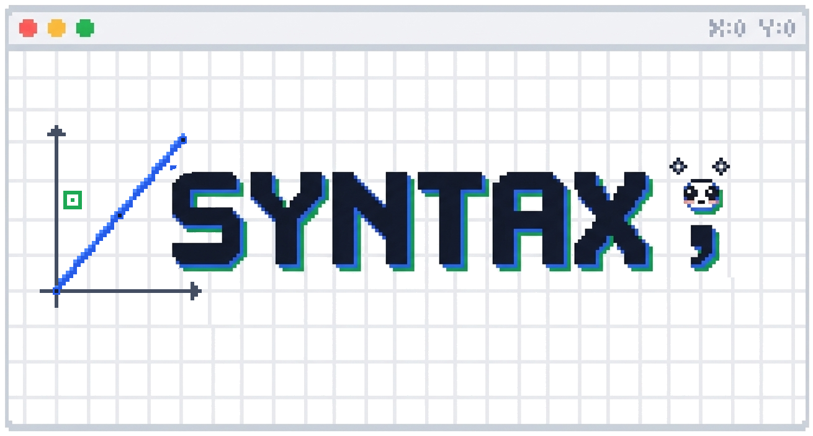

<p align="center">
  <a href="https://syntax-platform.github.io/syntax/">
    <picture>
      <source media="(prefers-color-scheme: dark)" srcset="public/assets/syntax-pixel-banner-dark.png" />
      <source media="(prefers-color-scheme: light)" srcset="public/assets/syntax-pixel-banner-light.png" />
      
    </picture>
  </a>
</p>

<h1 align="center">Syntax</h1>

<p align="center">An open-source, extensible browser workspace and learning platform.</p>

<p align="center">
  <a href="https://syntax-platform.github.io/syntax/"><strong>Launch</strong></a> ·
  <a href="https://syntax-platform.github.io/syntax-dev/">Syntax Dev</a> ·
  <a href="https://github.com/syntax-platform/syntax-official-plugins">Official Extensions</a> ·
  <a href="https://syntax-platform.github.io/syntax-community/">Community Hub</a> ·
  <a href="https://github.com/syntax-platform/syntax/releases">Releases</a>
</p>

Syntax is a fast, browser-native workspace built around isolated extensions. Standalone tools, embedded extensions, interactive study engines, and courses install cleanly without being hardcoded into one monolith.

## What you get

- **Isolated extensions.** Each extension runs background code in its own Web Worker and renders custom screens or embedded widgets inside opaque-origin sandboxed iframes. See [docs/extensions/ARCHITECTURE.md](docs/extensions/ARCHITECTURE.md).
- **Zero-crash collaboration.** Extensions share capabilities through versioned services with semver validation, staged updates, Safe Mode recovery (`?safeMode=1`), and user-owned documents that survive uninstall.
- **Runs in the browser.** Static web app with nothing to install.
- **Accounts and sync.** Sign in with passkeys, Google, or Apple to sync preferences across devices.
- **Sema.** An interactive companion that lives alongside your workspace.
- **Open source.** Built in the open so anyone can write and share extensions using plain ES modules and HTML.

## Ecosystem

| Repository | Purpose |
| :--- | :--- |
| [`syntax`](https://github.com/syntax-platform/syntax) | Core Syntax web app, shell, and Extensions v1 runtime |
| [`syntax-official-plugins`](https://github.com/syntax-platform/syntax-official-plugins) | Official courses and extensions maintained by the Syntax team |
| [`syntax-community`](https://github.com/syntax-platform/syntax-community) | Community catalog for third-party extensions |
| [`syntax-dev`](https://github.com/syntax-platform/syntax-dev) | Nightly pre-release builds deployed from `syntax` |

## Development

```bash
git clone https://github.com/syntax-platform/syntax.git
cd syntax
npm install
npm run dev
```

Useful scripts:

- `npm run test:unit`: Run Node unit tests for manifest validation, semver, stores, services, and documents.
- `npm run test:e2e`: Run the full 15-criterion Chromium end-to-end and soak suite against a live Vite dev server.
- `npm run build`: Type-check (`tsc -b`) and build the production bundle.

## Contributing

Bug reports, focused pull requests, and community extensions are welcome. Open an issue before starting large architectural changes.

## License

MIT.
