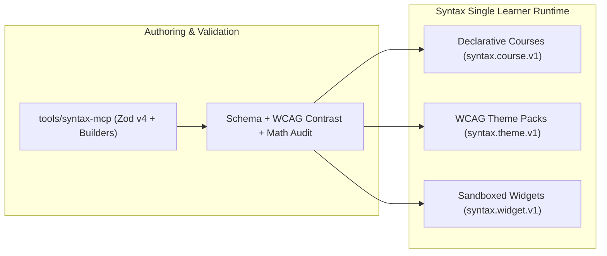

<a id="top"></a>

<p align="center">
  <a href="https://syntax-platform.github.io/syntax/">
    <picture>
      <source media="(prefers-color-scheme: dark)" srcset="public/assets/syntax-pixel-banner-dark.png" />
      <source media="(prefers-color-scheme: light)" srcset="public/assets/syntax-pixel-banner-light.png" />
      
    </picture>
  </a>
</p>

<h3 align="center">Visual, interactive math and computer science learning built for real understanding.</h3>

<p align="center">
  <a href="https://syntax-platform.github.io/syntax/"></a>
  <a href="https://syntax-platform.github.io/syntax-community/"></a>
  <a href="https://github.com/syntax-platform/syntax/stargazers"></a>
</p>

<p align="center">
  <a href="#what-you-can-learn">Courses</a>
  &nbsp;&middot;&nbsp;
  <a href="#interactive-workspace">Workspace</a>
  &nbsp;&middot;&nbsp;
  <a href="#mathematical-exactness">Math Engine</a>
  &nbsp;&middot;&nbsp;
  <a href="#extensibility">Extensibility</a>
  &nbsp;&middot;&nbsp;
  <a href="#mcp-authoring">MCP Authoring</a>
  &nbsp;&middot;&nbsp;
  <a href="#quick-start">Quick Start</a>
</p>

---

> [!TIP]
> **Free, open, and 100% client-side.** Interactive coordinate planes, algebraic grading without `eval()`, Pen Studio handwriting, guided Manim walkthroughs, WCAG-verified Theme Packs, and Clerk Cloud Sync all run straight in the browser.

<a id="what-you-can-learn"></a>
## What You Can Learn

| Course | Inside the Curriculum | Runtime |
| :--- | :--- | :--- |
| **Analytic Geometry (MPM2D)** | 23 lessons, 335 mathematically verified `GeoScene` figures, 7 Catch-Up rescue paths, interactive slope/midpoint/circle checks | [`GeoLessonPlayer.tsx`](src/mpm2d/GeoLessonPlayer.tsx) |
| **Thinking in Code (CS)** | Writing Programs, Sequencing Commands, Repeating Patterns, Debugging Programs, live robot grid execution with visual `Why?` replays | [`LessonSession.tsx`](src/lessons/LessonSession.tsx) |
| **Community Courses** | Declarative `syntax.course.v1` JSON courses with multiple-choice, zero-`eval` algebraic inputs, hints, and isolated embedded widgets | [`CustomCourseStage.tsx`](src/stages/CustomCourseStage.tsx) |

<a id="interactive-workspace"></a>
## Interactive Study Workspace

- **Pen Studio** ([`src/mpm2d/pen/`](src/mpm2d/pen)): Split-screen and fullscreen `tldraw` math scratchpad beside every problem, with graph, dot, and lined paper styles.
- **Guided Video Walkthroughs** ([`src/mpm2d/walkthrough/`](src/mpm2d/walkthrough)): Manim Community Edition scenes rendered as seekable MP4s with chapter markers, WebVTT captions, Video.js 10 (`@videojs/react`), and draggable WinBox study windows.
- **Sema Companion** ([`Sema.tsx`](src/mpm2d/mascot/Sema.tsx)): Parametric 3D spherical-eye semicolon mascot with 16 expressions, 8 morph shapes, elastic drag physics, and synchronized walkthrough choreography.
- **WCAG Theme Packs** ([`themePacks.ts`](src/core/themePacks.ts)): Pure JSON `syntax.theme.v1` color palettes validated automatically for >= 4.5:1 text contrast before applying.
- **Clerk Auth & Cloud Sync** ([`clerkAuth.tsx`](src/core/clerkAuth.tsx), [`clerkSync.ts`](src/core/clerkSync.ts)): Passkeys, Google and Apple OAuth, optional 2FA, multi-session account switching, and automatic cross-device sync of progress, Sema style, theme pack, and workspace tools.

<a id="mathematical-exactness"></a>
## Mathematical Exactness

Geometry diagrams in Syntax are computed from exact equations rather than hand-placed guesses[^1]:

$$m_\perp = -\frac{1}{m}, \qquad M = \left(\frac{x_1 + x_2}{2},\; \frac{y_1 + y_2}{2}\right), \qquad d = \sqrt{(x_2 - x_1)^2 + (y_2 - y_1)^2}$$

- Every coordinate plane enforces an **isotropic 1:1 aspect ratio** so perpendicular lines visually intersect at an exact $90^\circ$ angle.
- [`mathParser.ts`](src/mpm2d/mathParser.ts) evaluates fractions, radicals (`6√2`, `sqrt(72)`), unary powers (`-3^2 = -9`, `(-3)^2 = 9`), linear equations, and circle equations using a **zero-`eval` recursive-descent parser**.
- Fast keyboard navigation everywhere: press <kbd>/</kbd> to search, <kbd>F</kbd> for the Formula Playbook, <kbd>Enter</kbd> to check, and <kbd>Esc</kbd> to close dialogs.

<a id="extensibility"></a>
## Extensibility & Zero-Trust Model



> [!IMPORTANT]
> **Untrusted manifests never decide their own trust.** Badges, reserved official IDs, contrast checks, and capability disclosures are computed strictly by host code in [`src/contracts/`](src/contracts/index.ts), [`src/core/registry.ts`](src/core/registry.ts), and [`src/core/sandbox.tsx`](src/core/sandbox.tsx).

<details>
<summary><strong>Security boundaries under the hood</strong></summary>

1. **Zero untrusted JS in courses**: Community courses are declarative JSON validated by Zod v4 and rendered natively by Syntax's runtime.
2. **Zero CSS injection in themes**: Theme packs supply hex color tokens only, checked against WCAG 2.1 luminance ratios (>= 4.5:1 body and accent contrast).
3. **Opaque widget sandboxing**: Interactive widgets run inside `sandbox="allow-scripts"` iframes with `default-src 'none'`, `form-action 'none'`, `base-uri 'none'`, strict `event.origin === 'null'` and `e.source === window.parent` checks, navigation termination, and bounded error reporting.

</details>

<a id="mcp-authoring"></a>
## MCP Authoring Toolkit (`tools/syntax-mcp`)

[`tools/syntax-mcp/`](tools/syntax-mcp/src/server.ts) connects AI coding agents directly to Syntax's geometry engine over Model Context Protocol so scenes are constructed deterministically:

```ts
const ops = [
  { op: 'line_through', id: 'base', a: [-2, 1], b: [4, 4] },
  { op: 'midpoint', a: [-2, 1], b: [4, 4], label: 'M' },
  { op: 'perpendicular_through', baseLineId: 'base', through: [1, 2.5], id: 'perp' },
  { op: 'right_angle_at_intersection', line1Id: 'base', line2Id: 'perp' },
]
```

<a id="quick-start"></a>
## Quick Start

```bash
git clone https://github.com/syntax-platform/syntax.git
cd syntax
npm install
npm run dev
```

<details>
<summary><strong>Development & Verification Scripts</strong></summary>

| Command | Purpose |
| :--- | :--- |
| `npm run dev` | Start the local Vite development server |
| `npm run build` | Type-check (`tsc -b`) and build the production bundle |
| `npm run verify:graphs` | Verify bounds, orthogonality, grader round-trips, and label spacing across all 335 GeoScenes |
| `npm --prefix tools/syntax-mcp run build` | Build the `syntax-mcp` server and authoring CLI |
| `npm run verify:walkthroughs` | Run Manim `SyntaxVerifier` isotropic lock-on and visual checks |

</details>

---

[^1]: Every `GeoScene` diagram is checked mathematically by [`scripts/verify-graphs.mjs`](scripts/verify-graphs.mjs) on every build.

<p align="right"><a href="#top">Back to top &uarr;</a></p>
