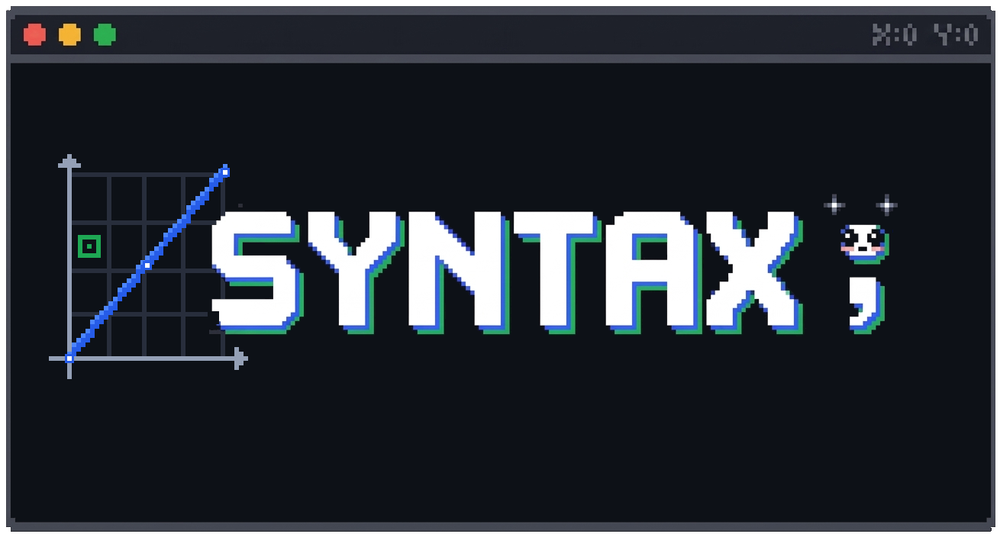
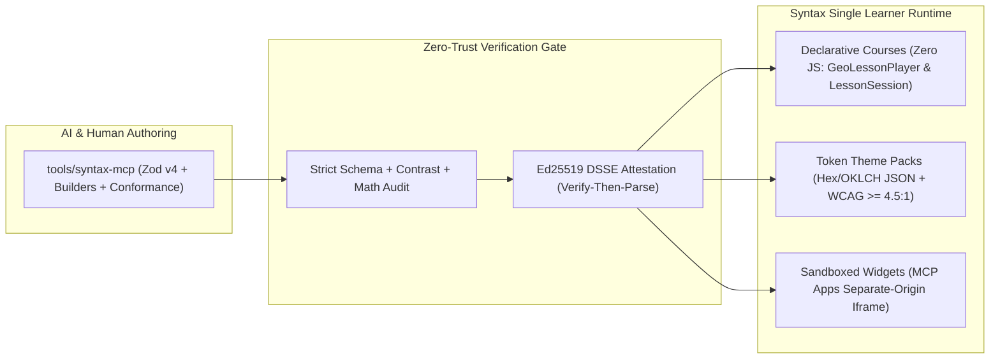

<a id="top"></a>

<p align="center">
  <a href="https://syntax-platform.github.io/syntax/">
    <picture>
      <source media="(prefers-color-scheme: dark)" srcset="public/assets/syntax-pixel-banner-dark.png" />
      <source media="(prefers-color-scheme: light)" srcset="public/assets/syntax-pixel-banner-light.png" />
      
    </picture>
  </a>
</p>

<p align="center">
  <a href="https://syntax-platform.github.io/syntax/"></a>
  <a href="https://syntax-platform.github.io/syntax/dev/"></a>
  <a href="https://syntax-platform.github.io/syntax-community/"></a>
  <a href="https://github.com/syntax-platform/syntax/releases"></a>
</p>

<p align="center">
  <strong>
    <a href="#live-channels">Live Channels</a>
    &nbsp;&bull;&nbsp;
    <a href="#learning-modules">Modules</a>
    &nbsp;&bull;&nbsp;
    <a href="#architecture">Architecture</a>
    &nbsp;&bull;&nbsp;
    <a href="#security-model">Zero-Trust Model</a>
    &nbsp;&bull;&nbsp;
    <a href="#mcp-authoring">MCP Authoring</a>
    &nbsp;&bull;&nbsp;
    <a href="#local-development">Quick Start</a>
    &nbsp;&bull;&nbsp;
    <a href="#roadmap">Roadmap</a>
  </strong>
</p>

---

> [!TIP]
> **Built for visual intuition, mathematical exactness, and $0/month static hosting.** Every coordinate graph, algebraic grader, grid interpreter, and guided walkthrough runs client-side with zero paywalls, zero `eval()`, and deterministic verification across 335+ scenes.

<a id="live-channels"></a>
## Live Channels

Everything deploys automatically via [GitHub Actions](.github/workflows) at **$0/month**:

| Channel | URL | Trigger | Purpose |
| :--- | :--- | :--- | :--- |
| **Syntax Stable** | [syntax-platform.github.io/syntax](https://syntax-platform.github.io/syntax/) | Tagged `vX.Y.Z` ([release-main.yml](.github/workflows/release-main.yml)) | Production learner workspace |
| **Syntax Dev** | [syntax-platform.github.io/syntax/dev](https://syntax-platform.github.io/syntax/dev/) | Pre-release `vX.Y.Z-alpha.N` ([release-dev.yml](.github/workflows/release-dev.yml)) | Diagnostics, new engines, preview builds |
| **Community Hub** | [syntax-platform.github.io/syntax-community](https://syntax-platform.github.io/syntax-community/) | Catalog manifest sync | Verified community courses and extensions |

---

<a id="learning-modules"></a>
## Learning Modules & Core Systems

| Module | Core Runtime | Key Capabilities |
| :--- | :--- | :--- |
| **Analytic Geometry (MPM2D)** | [`GeoLessonPlayer.tsx`](src/mpm2d/GeoLessonPlayer.tsx) | 23 lessons, 335 verified `GeoScene` diagrams, 7 Catch-Up rescue paths, interactive coordinate planes, zero-`eval` algebraic grading ([`mathParser.ts`](src/mpm2d/mathParser.ts)) |
| **Thinking in Code (CS)** | [`LessonSession.tsx`](src/lessons/LessonSession.tsx) | Writing Programs, Sequencing Commands, Repeating Patterns, Debugging Programs, live robot/delivery grid execution, animated `Why?` explanations |
| **Pen Studio** | [`src/mpm2d/pen/`](src/mpm2d/pen) | Split-screen and fullscreen `tldraw` math scratchpad with per-question ink history sync and 3D drawer HUD |
| **Guided Walkthroughs** | [`src/mpm2d/walkthrough/`](src/mpm2d/walkthrough) | Manim Community Edition scenes (`en-US-AndrewNeural`), single seekable per-lens MP4s, WebVTT chapters, Video.js 10 (`@videojs/react`), WinBox windows |
| **Sema Companion** | [`Sema.tsx`](src/mpm2d/mascot/Sema.tsx) | Parametric 3D spherical-eye semicolon companion with 16 expressions, 8 morph shapes, elastic drag physics, and synchronized video choreography |

### Mathematical Exactness Built Into the Engine

Syntax treats geometry as computable truth rather than hand-typed coordinates[^1]:

$$m_\perp = -\frac{1}{m}, \qquad M = \left(\frac{x_1 + x_2}{2},\; \frac{y_1 + y_2}{2}\right), \qquad d = \sqrt{(x_2 - x_1)^2 + (y_2 - y_1)^2}$$

- Every coordinate plane enforces an **isotropic 1:1 aspect ratio** so perpendicular lines visually meet at an exact $90^\circ$ angle rather than looking skewed.
- [`mathParser.ts`](src/mpm2d/mathParser.ts) parses fractions, radicals (`6√2`, `sqrt(72)`), unary powers (`-3^2 = -9`, `(-3)^2 = 9`), linear equations, and circle equations via a **zero-`eval` recursive-descent parser** safe under strict CSP.
- Keyboard shortcuts stay fast everywhere: press <kbd>/</kbd> to focus search, <kbd>Enter</kbd> to submit or step, and <kbd>Esc</kbd> to dismiss active drawers or dialogs.

---

<a id="architecture"></a>
## Architecture & Extensibility v2

Syntax follows an inward-separated single-runtime design inspired by **Khan Academy Perseus**, **Chrome MV3**, **VS Code**, **Figma**, and **MCP Apps (SEP-1865)**:



<a id="security-model"></a>
## Zero-Trust Security Model

> [!IMPORTANT]
> **Untrusted manifests can never declare their own trust.** Badges (`Official`, `Verified`), scan results, and capability disclosures are computed strictly by host code and verified cryptographic signatures, never from author-supplied JSON fields or prose.

<details>
<summary><strong>Deep Dive: Why Syntax Separates Data, Themes, and Sandboxed Code</strong></summary>

1. **Courses are pure declarative data (zero untrusted JS)**: Modeled after Khan Academy Perseus (`perseus-core` + `perseus-score`), lessons declare structured scenes, steps, and rubrics validated by Zod v4 (`z.toJSONSchema()`) and rendered natively on Syntax's single lesson runtime.
2. **Host-derived immutable disclosures (Chrome MV3 rule)**: Extensions request machine-readable capability tokens only. The Syntax host maps each token to compiled host-owned warning copy and auto-disables extensions on update privilege escalation.
3. **Strict sandbox isolation (Figma + MCP Apps rule)**: Interactive code widgets execute inside an opaque `sandbox="allow-scripts"` iframe (no `allow-same-origin`, no `allow-forms`, no `allow-modals`, explicit `form-action 'none'` and `base-uri 'none'`, strict `event.origin === 'null'` + navigation kill switch, moving to a separate-origin Cloudflare Pages `sandbox.html` proxy with real HTTP CSP headers).
4. **Audited libraries over hand-rolled plumbing**: Built on `zod`, `zustand`, `react-error-boundary`, `@base-ui/react`, `@clerk/react`, `@videojs/react`, `@rive-app/webgl2`, and `tldraw`, with `@modelcontextprotocol/ext-apps`, `@noble/ed25519`, `culori`, and `@cortex-js/compute-engine` planned for Extensibility v2[^2].

</details>

---

<a id="mcp-authoring"></a>
## MCP Authoring Toolkit (`tools/syntax-mcp`)

[`tools/syntax-mcp/`](tools/syntax-mcp/src/server.ts) exposes Syntax's live math/geometry runtime to AI authoring agents over Model Context Protocol so courses are **constructed by correctness** instead of guessed:

```ts
// Example: deterministic geometric scene construction via syntax_author_scene
const ops = [
  { op: 'line_through', id: 'base', a: [-2, 1], b: [4, 4] },
  { op: 'midpoint', a: [-2, 1], b: [4, 4], label: 'M' },
  { op: 'perpendicular_through', baseLineId: 'base', through: [1, 2.5], id: 'perp' },
  { op: 'right_angle_at_intersection', line1Id: 'base', line2Id: 'perp' },
]
```

<details>
<summary><strong>Available MCP & Verification Commands</strong></summary>

| Command | Script / Entrypoint | What It Verifies |
| :--- | :--- | :--- |
| `npm run verify:graphs` | [`scripts/verify-graphs.mjs`](scripts/verify-graphs.mjs) | Mathematical bounds, orthogonality, grader round-trips, and label collision checks across all 335 GeoScenes |
| `npm run build` | `tsc -b && vite build` | Strict TypeScript project build and production Vite bundle |
| `npm --prefix tools/syntax-mcp run build` | [`tools/syntax-mcp/src/server.ts`](tools/syntax-mcp/src/server.ts) | Compiles the `syntax-mcp` server and `syntax-cli` authoring binary |
| `npm run verify:walkthroughs` | `manim-pipeline/render.py --verify-only` | Manim `SyntaxVerifier` isotropic lock-on and no-slop gates |

</details>

<a id="local-development"></a>
## Quick Start

```bash
git clone https://github.com/syntax-platform/syntax.git
cd syntax
npm install
npm run dev
```

> [!NOTE]
> **Optional Clerk Auth**: Copy `.env.example` to `.env.local` and set `VITE_CLERK_PUBLISHABLE_KEY`. For GitHub Pages channels, configure `VITE_CLERK_PUBLISHABLE_KEY` as a GitHub Actions Repository Variable. Automated PR reviews are configured in [`.coderabbit.yaml`](.coderabbit.yaml).

<a id="roadmap"></a>
## Extensibility v2 Roadmap

- [x] Revert unverified hand-rolled plugin plumbing and add assertive [`.coderabbit.yaml`](.coderabbit.yaml) reviews ([#1](https://github.com/syntax-platform/syntax/pull/1))
- [x] Quarantine untrusted pre-install previews, trust-field spoofing, dead files, and `Function()` eval in [`mathParser.ts`](src/mpm2d/mathParser.ts) ([#2](https://github.com/syntax-platform/syntax/pull/2))
- [ ] Move built-in tools (`Pen Studio`, `Walkthroughs`, `Floating Windows`, `Formula Playbook`) into Workspace Preferences and ship shared Zod v4 `src/contracts/`
- [ ] Converge all courses onto one declarative `syntax.course.v1` runtime with `@cortex-js/compute-engine` symbolic grading and dedicated `/courses` navigation
- [ ] Ship `/extensions` with WCAG-verified `syntax.theme.v1` JSON palettes and `@modelcontextprotocol/ext-apps` separate-origin sandboxed widgets
- [ ] Upgrade [`tools/syntax-mcp`](tools/syntax-mcp/src/server.ts) with `McpServer` structured outputs, MCP Resources/Prompts, Playwright conformance gates, and Ed25519 DSSE CI signing

---

[^1]: All 335 Grade 10 `GeoScene` figures are checked automatically by `npm run verify:graphs` before release.
[^2]: Cryptography runs through Cure53-audited `@noble/ed25519` rather than WebCrypto Ed25519 alone so managed school Chromebooks (Chrome 126 to 136 LTS) verify attestations identically.

<p align="right"><a href="#top">Back to top &uarr;</a></p>
