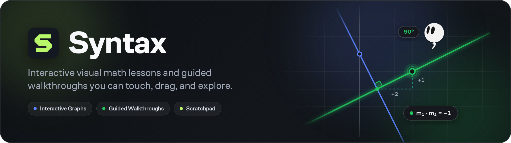

<p align="center">
  <a href="https://i-am-drunk.github.io/syntax/">
    <picture>
      <source media="(prefers-color-scheme: dark)" srcset="public/assets/syntax-banner-dark.png" />
      <source media="(prefers-color-scheme: light)" srcset="public/assets/syntax-banner-light.png" />
      
    </picture>
  </a>
</p>

<p align="center">
  <a href="https://i-am-drunk.github.io/syntax/"><strong>Open Syntax</strong></a>
  &nbsp;&middot;&nbsp;
  <a href="https://i-am-drunk.github.io/syntax/dev/"><strong>Open Syntax Dev</strong></a>
  &nbsp;&middot;&nbsp;
  <a href="https://i-am-drunk.github.io/syntax-community/"><strong>Community Hub</strong></a>
  &nbsp;&middot;&nbsp;
  <a href="https://github.com/I-am-drunk/syntax/releases">Releases</a>
</p>

---

## Live Sites

Everything runs at $0/month via GitHub Pages:

| Site | Link | Channel |
| --- | --- | --- |
| **Syntax** | [i-am-drunk.github.io/syntax](https://i-am-drunk.github.io/syntax/) | Stable releases (`vX.Y.Z`) |
| **Syntax Dev** | [i-am-drunk.github.io/syntax/dev](https://i-am-drunk.github.io/syntax/dev/) | Alpha pre-releases (`vX.Y.Z-alpha.N`) |
| **Community Hub** | [i-am-drunk.github.io/syntax-community](https://i-am-drunk.github.io/syntax-community/) | Community catalog and package discovery |

## Package Architecture

Syntax separates Core from courses and tools using three clear package formats:

- **`.syntaxcourse`**: Interactive courses (for example Analytic Geometry MPM2D and Thinking in Code) with lessons, checks, and declared embedded plugin requirements.
- **`.syntaxplugin`**: Global app tools (Pen Studio, Video Walkthroughs, Checkmark Gate, Floating Windows, Work History, Formula Playbook). Any plugin that touches Syntax core displays an unmistakable warning: **"This plugin touches core."**
- **`.syntaxembeddedplugin`**: Reusable course libraries (Math Graph Engine, Grid Coding Engine, Unit Circle Lab) that include an **AI Usage Card** so AI connectors (Claude, ChatGPT, MCP) can discover and reuse them.

## Production Libraries

Built on small, maintained late-2026 libraries instead of hand-rolled plumbing:

- **`zod`** for package manifest validation and typed schemas
- **`zustand`** for persisted package registry and account state
- **`firebase/auth`** for $0/month Google, GitHub, and Email sign-in on GitHub Pages (with zero custom domain and zero inactivity pausing)
- **`wouter`** for tiny hash-based SPA routing on GitHub Pages
- **`react-error-boundary`** for crash isolation and diagnostics logging (Sentry and PostHog ready)

## Run Locally

```bash
npm install
npm run dev
```

To enable live Firebase Auth locally, copy `.env.example` to `.env.local` and fill in your Firebase web config. For GitHub Pages production deployments, add those same four `VITE_FIREBASE_*` keys as GitHub Actions Repository Variables.
